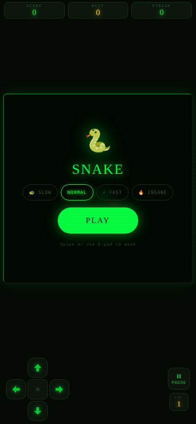
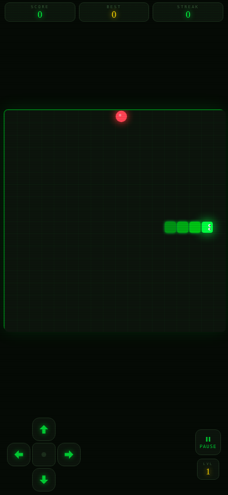

# 🐍 Snake Game — Mobile Web Edition

> A fully-featured Snake game built with pure HTML5 Canvas, CSS animations, and JavaScript.  
> No frameworks, no dependencies — just open `index.html` and play! 🎮

---

## 📸 Demo Screenshots

| Start Screen | Playing |
|:---:|:---:|
|  |  |

---

## 🌟 Features

| Feature | Description |
|---|---|
| 🎨 **Neon Matrix Design** | Dark green CRT-style theme with glowing neon snake |
| 📱 **Mobile First** | Swipe gestures + D-pad controller for phones |
| ⌨️ **Keyboard Support** | Arrow keys or WASD for desktop players |
| 🔥 **Combo System** | Eat 3 in a row → x2 points, eat 5 in a row → x3 points! |
| 🏆 **High Score** | Your best score is saved even after closing the browser |
| 🎚️ **4 Speed Levels** | Slow 🐢 / Normal / Fast ⚡ / Insane 🔥 |
| 📈 **Auto Level-Up** | Every 80 points the snake speeds up automatically |
| 💥 **Particles** | Colorful explosion particles every time you eat food |
| 📳 **Haptic Feedback** | Vibration on Android when you eat or die |
| ⏸️ **Pause / Resume** | Pause the game anytime |
| 🔁 **Wall Wrap** | Snake wraps around the edges — no wall death! |

---

## 🚀 How to Run Locally

### Option 1 — Easiest (Just Double-Click)
```
1. Download or clone this project
2. Double-click  index.html
3. It opens in your browser — start playing immediately!
```
> ✅ Works in Chrome, Firefox, Safari, Edge — no installation needed.

### Option 2 — Run on Your Phone Right Now
```
1. Email yourself the index.html file
2. Open the email on your phone
3. Tap the file to open it in your mobile browser
4. On iPhone: tap Share → Add to Home Screen  📱
5. On Android: tap Menu → Add to Home Screen  📱
```

### Option 3 — Local Server (for developers)
```bash
# If you have Python installed:
python3 -m http.server 8000

# Then open in your browser:
http://localhost:8000
```

---

## 🎮 How to Play

### Controls

| Input | Action |
|---|---|
| **Swipe** anywhere on screen | Change direction |
| **D-pad buttons** (↑ ↓ ← →) | Change direction |
| **Arrow keys** / **WASD** | Change direction (desktop) |
| **P key** | Pause / Resume |
| **Pause button** | Pause / Resume |

### Game Rules

```
🍎  Eat the red food to grow and score points
🔥  Eat multiple food in a row for combo multiplier
💀  Hit your own tail = Game Over
🔁  Hitting a wall wraps you to the other side (no death!)
📈  Every 80 points you level up and speed increases
```

### Scoring System

```
Base score per food:   10 × current level
Combo x2 (3 in a row): 20 × current level
Combo x3 (5 in a row): 30 × current level
```

**Example:** At Level 3 with a x3 combo → `10 × 3 × 3 = 90 points per food!`

---

## 📁 Project Structure

```
snake-game/
│
├── index.html          ← The complete game (all-in-one file!)
├── README.md           ← This documentation file
│
└── assets/
    ├── demo-start.png  ← Screenshot: start screen
    ├── demo-playing.png← Screenshot: gameplay
    ├── icon-192.svg   
    └── icon-512.svg    
```

---

## 🧠 Code Architecture

The game is split into clear sections inside `index.html`:

```
index.html
│
├── <head>                   CSS variables, fonts, animations
│   └── <style>
│       ├── :root {}         Color palette as CSS variables
│       ├── .topbar {}       Score / Best / Streak display
│       ├── .board-area {}   Game canvas container
│       ├── .overlay {}      Start / Game Over screen
│       ├── .dpad {}         D-pad controller buttons
│       └── @keyframes       popScore, floatEmoji, shakeX
│
├── <body>                   HTML layout
│   ├── .topbar              Score panels
│   ├── .board-area
│   │   ├── <canvas>         The game is drawn here
│   │   ├── .overlay         Start/GameOver screen
│   │   └── .pause-overlay   Pause screen
│   └── .controls
│       ├── .dpad            Direction buttons
│       └── .right-controls  Pause + Level display
│
└── <script>                 All game logic
    ├── Constants            COLS=18, ROWS=18, CELL size
    ├── State variables      snake[], dir, score, level...
    ├── resizeCanvas()       Makes board fit the screen
    ├── initGame()           Resets everything for a new game
    ├── placeFood()          Puts food in a random empty cell
    ├── startTicker(ms)      Starts game loop (safe restart)
    ├── tick()               Main game logic (runs every N ms)
    ├── endGame()            Stops game, shows Game Over
    ├── draw()               Renders frame on canvas
    ├── drawSnake()          Draws each snake segment
    ├── drawFood()           Draws pulsing food circle
    ├── drawParticles()      Draws explosion particles
    ├── rafLoop()            60fps render loop
    ├── handleSwipe*()       Touch/swipe detection
    └── applyDir()           Changes snake direction
```

---

## 💡 Key Code Concepts Explained

### 1. The Game Loop — Two Loops Working Together

```javascript
// LOGIC LOOP: runs every N milliseconds (controls game speed)
function startTicker(ms) {
  clearInterval(ticker);          // always clear old one first!
  ticker = setInterval(tick, ms); // create exactly ONE new timer
}

// RENDER LOOP: runs 60 times per second for smooth animation
function rafLoop() {
  draw();                         // draw current frame
  requestAnimationFrame(rafLoop); // schedule next frame
}
requestAnimationFrame(rafLoop);   // start it immediately
```

> ⚠️ **Why two loops?** The game *logic* (moving snake, checking collisions) only needs
> to run ~9 times per second. But the *rendering* (food pulse animation, particles) needs
> to run at 60fps to look smooth. Separating them gives the best of both worlds!

---

### 2. Snake Movement — Array Trick

```javascript
// Snake is stored as an array of {x, y} positions
// Head is always snake[0], tail is snake[snake.length-1]

// To MOVE the snake:
snake.unshift(newHead);  // add new head at front  → snake grows by 1
snake.pop();             // remove tail at back     → snake stays same length

// To GROW the snake (when food is eaten):
snake.unshift(newHead);  // add new head at front  → snake grows by 1
// DON'T call snake.pop() → tail stays → snake is now 1 longer! 🐍
```

---

### 3. Wall Wrap — Modulo Math

```javascript
// Instead of bouncing off walls, use modulo (%) to wrap around
const head = {
  x: (snake[0].x + dir.x + COLS) % COLS,  // wrap left/right
  y: (snake[0].y + dir.y + ROWS) % ROWS   // wrap top/bottom
};

// Example: if x = 17 (right edge) and dir.x = 1 (moving right)
// (17 + 1 + 18) % 18 = 36 % 18 = 0   → appears on left side! ✨
```

---

### 4. High Score — localStorage

```javascript
// Save to browser storage
localStorage.setItem('snakeBestM', best);

// Read it back (even after browser closes and reopens)
let best = parseInt(localStorage.getItem('snakeBestM') || '0');
```

---

### 5. Swipe Detection

```javascript
let startX, startY;

// Record where the touch started
body.addEventListener('touchstart', e => {
  startX = e.touches[0].clientX;
  startY = e.touches[0].clientY;
});

// When finger lifts, calculate swipe direction
body.addEventListener('touchend', e => {
  const dx = e.changedTouches[0].clientX - startX;
  const dy = e.changedTouches[0].clientY - startY;
  
  if (Math.abs(dx) > Math.abs(dy)) {
    // Horizontal swipe
    nextDir = dx > 0 ? { x: 1, y: 0 } : { x: -1, y: 0 };
  } else {
    // Vertical swipe
    nextDir = dy > 0 ? { x: 0, y: 1 } : { x: 0, y: -1 };
  }
});
```

---

## 🌍 Deployment Guide

### ✅ Option 1 — GitHub Pages (Free! Recommended)

GitHub Pages lets you host any static HTML file for **free** with a public URL.

#### Step-by-Step:

**1. Create a GitHub account** (if you don't have one)
- Go to [github.com](https://github.com) → Sign Up

**2. Create a new repository**
```
GitHub → "+" button (top right) → New repository
Repository name: snake-game    (or any name you like)
Visibility: Public             ✅  (required for free Pages)
Click: "Create repository"
```

**3. Upload your files**
```
On your new repo page → "uploading an existing file" link
Drag and drop:  index.html  and the  assets/  folder
Scroll down → "Commit changes" button → Click it
```

**4. Enable GitHub Pages**
```
Repository → Settings tab → Pages (left sidebar)
Source: "Deploy from a branch"
Branch: main    /    (root)
Click: Save
```

**5. Wait ~60 seconds, then your game is live at:**
```
https://YOUR-USERNAME.github.io/snake-game/
```

> 🎉 Share this URL with anyone in the world — they can play right in their browser!

---

### Option 2 — Netlify Drop (Fastest, no account needed)

```
1. Go to: https://app.netlify.com/drop
2. Drag your entire  snake-game/  folder onto the page
3. Netlify gives you a URL instantly! (e.g. random-name-123.netlify.app)
4. Optional: Create a free account to keep the URL permanently
```

---

### Option 3 — Tiiny.host (Simplest for sharing)

```
1. Go to: https://tiiny.host
2. Upload your  index.html  file
3. Choose a custom name (e.g. my-snake-game)
4. Your game is live at: https://my-snake-game.tiiny.site
```

---

### Option 4 — Vercel

```bash
# Install Vercel CLI
npm install -g vercel

# In your project folder:
vercel

# Follow the prompts — your game goes live in ~30 seconds!
```

---

## 🛠️ Customization Ideas

Want to make it your own? Here are some easy changes:

```javascript
// Change grid size (in index.html, near top of <script>)
const COLS = 18, ROWS = 18;   // try 20x20 or 16x16

// Change colors (in <style>, :root section)
--green-1: #00ff41;   // main snake color — try #00ffff for blue!
--red:     #ff3333;   // food color — try #ffaa00 for orange

// Change points per food
const pts = 10 * level * multi;   // change 10 to 20 for double points

// Change level-up frequency (every N points)
const newLevel = Math.floor(score / 80) + 1;  // change 80 to 50 for faster levels
```

---

## 🐛 Known Bugs Fixed

| Bug | Cause | Fix |
|---|---|---|
| Game stops after 1st score | Duplicate `setInterval` on level up | `startTicker()` always clears old timer first |
| `IndexSizeError` crash | Particle radius went negative | `Math.max(0, p.r * p.life)` clamp + early return |
| Board too small on phone | UI elements taking too much space | Reduced padding, D-pad size, font sizes |

---

## 📚 Technologies Used

| Technology | What it's used for |
|---|---|
| **HTML5 Canvas API** | Drawing the snake, food, particles |
| **CSS Custom Properties** | Theming with variables |
| **CSS Animations** | Score pop, emoji float, shake |
| **JavaScript ES6+** | Game logic, classes, arrow functions |
| **Touch Events API** | Swipe detection on mobile |
| **localStorage API** | Saving high score |
| **Vibration API** | Haptic feedback on Android |
| **requestAnimationFrame** | Smooth 60fps rendering |
| **Google Fonts** | Space Mono + Bungee fonts |

---

## 👩‍💻 About This Project

This project was built as a learning exercise to explore:
- HTML5 Canvas game development
- Mobile-first responsive design
- JavaScript game loops and state management
- Touch/gesture input handling
- CSS animations and visual effects

**Original project:** [github.com/Maryamh12/Game_project](https://github.com/Maryamh12/Game_project)  
**Enhanced version:** Added Canvas rendering, mobile controls, animations, combo system, particles, and performance fixes.

---

## 📝 License

This project is open source — feel free to use, modify, and share it for learning purposes! 🎓

---

*Made with ❤️ and a lot of `console.log()` debugging*
